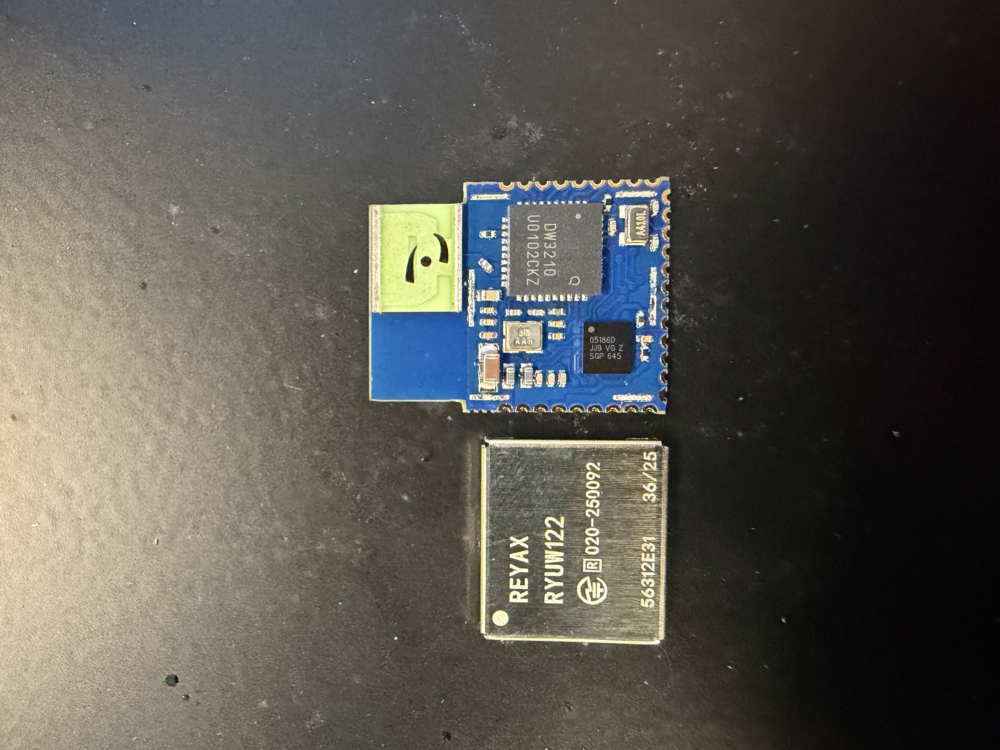
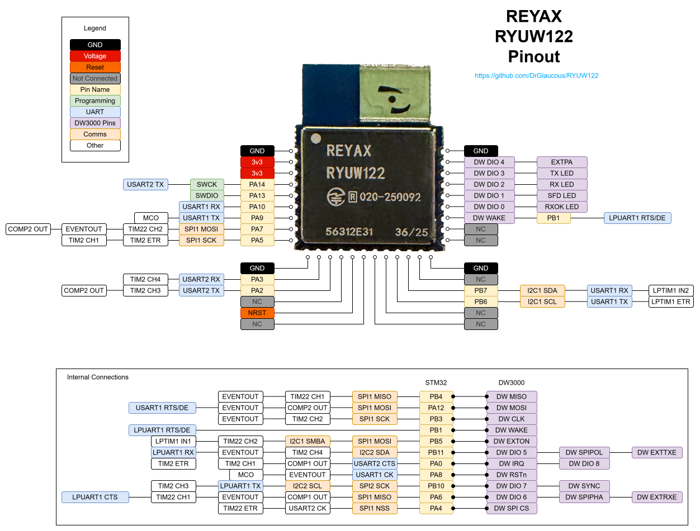
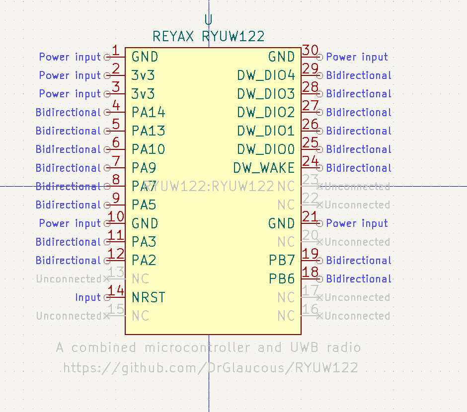
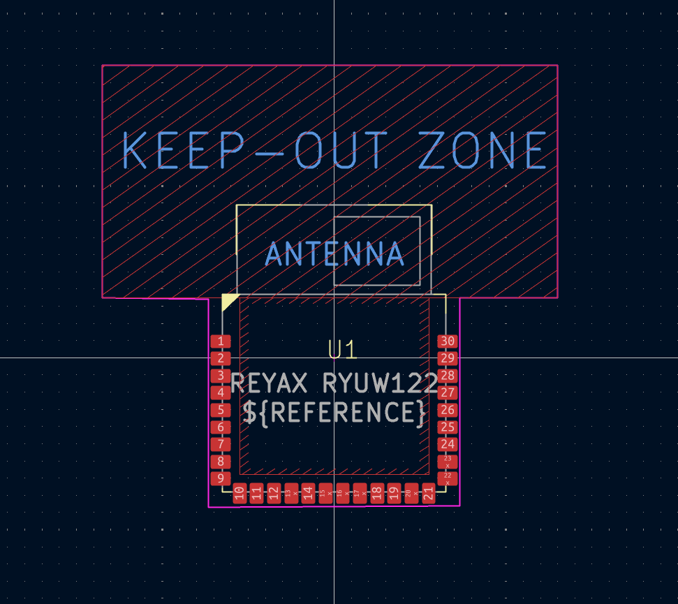

# RYUW122 Reverse engineering

<p align="center">
  
</p>

[https://reyax.com/product/UWB/RYUW122](https://reyax.com/product/UWB/RYUW122)

This little module contains a UWB radio and 32 bit microcontroller in a package roughly the size of a micro SD card (or a fingernail). Similar UWB modules containing the same hardware are physically larger and don't always integrate their own microcontroller, making the RYUW122 an attractive choice for small footprints since it has everything already, but much of the functionality of the model is locked behind a somewhat limited set of AT commands made by reyax.

The chips themselves are:
- DW3210 UWB radio
- STM32L051 with 64k of internal flash in a 36-ball WLCSP package

Fortunately, the programming interface for the STM32 is already broken out on the board, making it trivial to reprogram with custom code using one of those sub-$5 stlink-v2 dongles.

Unfortunately, there isn't any documentation (like schematics or internal pinouts) for people aiming to write custom firmware for this thing, so that's what I'm trying to figure out here.


## Unlocking the STM32 chip:

The microcontroller on this module comes flash-locked by default, so the contents of memory cannot be read back (which is unfortunate; it could've been used to deduce the pinout connections between the radio and the MCU)

This can be reverted at the cost of wiping the chip.

Before programming the chip for the first time, the following needs to be added to the platformio.ini file, run once, then removed. (because this doesn't actually perform an upload, it only unlocks the chip)
```ini
; upload flags to disable read-only mode on the STM32
upload_flags =
    -d2
    -f
    interface/stlink.cfg
    -f
    target/stm32l0.cfg
    -c
    init
    -c
    targets
    -c
    reset halt
    -c
    stm32l0x unlock 0
    -c
    reset run
    -c
    shutdown
upload_command = openocd $UPLOAD_FLAGS

```

This is the terminal response I got from doing that.
```
RAM:   [=         ]  10.4% (used 852 bytes from 8192 bytes)
Flash: [=         ]  11.7% (used 7644 bytes from 65536 bytes)
Configuring upload protocol...
AVAILABLE: blackmagic, cmsis-dap, jlink, mbed, stlink
CURRENT: upload_protocol = stlink
Uploading .pio\build\generic_stm32l051\firmware.elf
xPack OpenOCD, x86_64 Open On-Chip Debugger 0.10.0+dev-00378-ge5be992df (2020-06-26-09:29)
Licensed under GNU GPL v2
For bug reports, read
        http://openocd.org/doc/doxygen/bugs.html
debug_level: 2

Info : auto-selecting first available session transport "hla_swd". To override use 'transport select <transport>'.
Info : The selected transport took over low-level target control. The results might differ compared to plain JTAG/SWD
Info : clock speed 300 kHz
Info : STLINK V2J29S7 (API v2) VID:PID 0483:3748
Info : Target voltage: 3.243501
Info : stm32l0.cpu: hardware has 4 breakpoints, 2 watchpoints
Info : starting gdb server for stm32l0.cpu on 3333
Info : Listening on port 3333 for gdb connections
    TargetName         Type       Endian TapName            State       
--  ------------------ ---------- ------ ------------------ ------------
 0* stm32l0.cpu        hla_target little stm32l0.cpu        halted

Info : Unable to match requested speed 300 kHz, using 240 kHz
Info : Unable to match requested speed 300 kHz, using 240 kHz
target halted due to debug-request, current mode: Handler HardFault
xPSR: 0xf1000003 pc: 0xfffffffe msp: 00000000
Info : Device: STM32L0xx (Cat. 3)
Info : STM32L flash size is 64kb, base address is 0x8000000
STM32Lx unlocked, takes effect after power cycle.

Info : Unable to match requested speed 300 kHz, using 240 kHz
Info : Unable to match requested speed 300 kHz, using 240 kHz
shutdown command invoked
======================================================================================= [SUCCESS] Took 9.14 seconds =======================================================================================
 *  Terminal will be reused by tasks, press any key to close it. 
```


## Pins

Using a combination of macro photos, an arduino sketch and a multimeter, I was able to figure out the following connections:

<p align="center">
  
</p>


The following are the pin assignments on the STM32.

- **PA13**  - SWDIO
- **PA15**  - Not connected
- **PB4**  - DW3000 MISO
- **PB7**  - Broken out
- **PA12** - DW3000 MOSI
- **PA14** - SWCLK
- **PB3**  - DW3000 CLK
- **PB6**  - Broken out
- **PB8**  - Not connected
- **PA10** - Broken out
- **PA11** - Not connected
- **PB1**  - DW3000 Wakeup
- **PB5**  - DW3000 EXTON
- **PA9**  - Broken out
- **PB11** - DW3000 GPIO5
- **PB0**  - Not connected
- **PA0**  - DW3000 IRQ
- **PA8**  - DW3000 RSTn
- **PB10** - DW3000 GPIO7
- **PA6**  - DW3000 GPIO6
- **PA4**  - DW3000 CS
- **PA2**  - Broken out
- **PB2**  - Not connected
- **PA7**  - Broken out
- **PA5**  - Broken out
- **PA3**  - Broken out
- **PA1**  - Not connected


## Footprint and symbol

Reyax doesn't provide footprint and symbol downloads for this module. They do provide a CAD model though. I created some footprints for kicad 9.0 and included them in this repository.

<p align="center">
    
    
    
</p>

